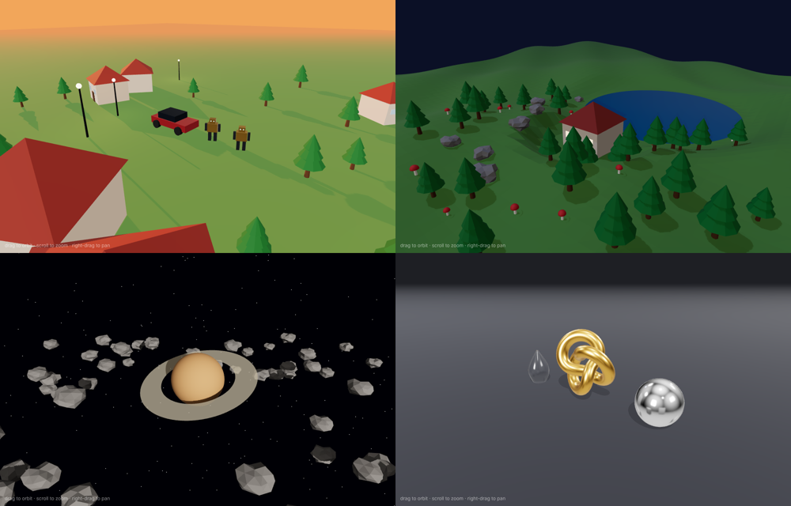
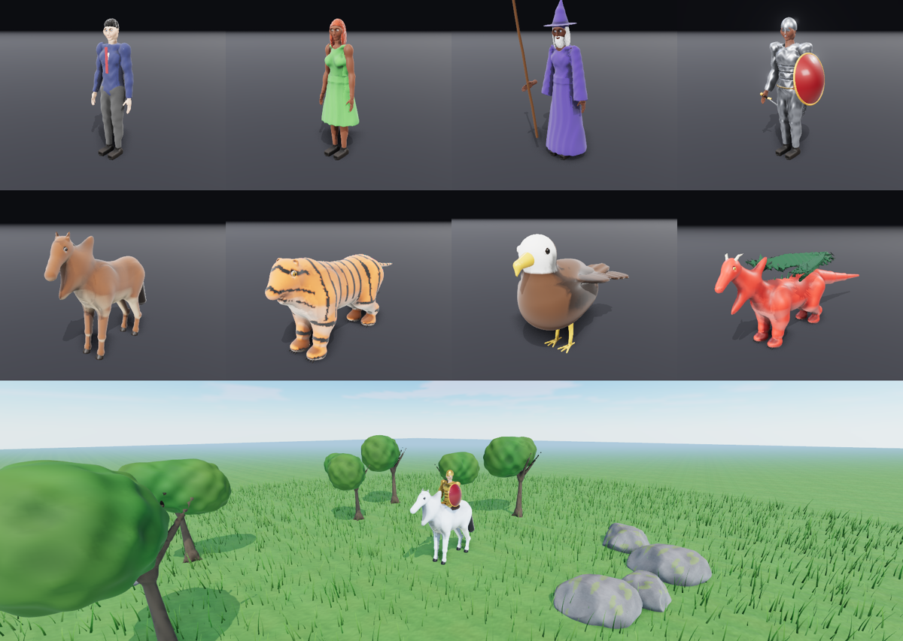
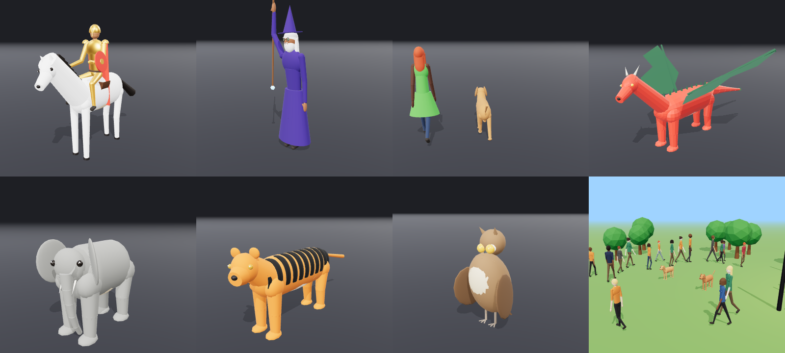

# ThreeJS Forge MCP

An MCP server that turns a sentence (or a JSON spec) into a **validated, modern three.js scene with realistic, sculpted models**: a self-contained `index.html` you can open, plus a reusable `scene.js` module you can drop into any app (Vite, React, Next, plain JS).

Inside, an **orchestrator** routes every request through **12 agents and 44 sub-agents**, each owning one job. Each one has a self-test, so you can check the whole tree on your own machine. Dedicated **character** and **creature** agents plan people, animals and fantasy creatures in detail before they are built.



*Generated from: "A cozy village at sunset with a red car and two rotating golden robots" · "a dense forest on hills with a cabin and a lake at night" · "saturn with 80 asteroids orbiting in space" · "studio product shot of a rotating glass vase, a gold torus knot and a chrome sphere".*

## Quick start

```bash
git clone https://github.com/chiru144/threejs-models.git
cd threejs-models
npm install
npm run doctor        # checks every agent + sub-agent in YOUR environment
npm test              # full test suite (136 tests, ~4 min: every archetype and species is sculpted)
```

### Connect it to your MCP client

**Claude Code**: this repo ships an `.mcp.json`, so opening Claude Code in the folder offers the server automatically. To use it from anywhere:

```bash
claude mcp add threejs-forge -- node /absolute/path/to/threejs-models/src/server.js
```

**Claude Desktop / Cursor / other clients**: add to the client's MCP config:

```json
{
  "mcpServers": {
    "threejs-forge": {
      "command": "node",
      "args": ["/absolute/path/to/threejs-models/src/server.js"],
      "env": { "THREEJS_FORGE_OUT": "/absolute/path/where/scenes/should/go" }
    }
  }
}
```

Then just ask: *"Use threejs-forge to build a snowy village at night with glowing windows and 3 floating crystals."* or *"Design an old wizard with a long white beard waving."*

## Tools

| Tool | What it does | Typical reply size |
|---|---|---|
| `forge_build` | Prompt or spec → `index.html` + `scene.js` + `spec.json`, validated in real three.js | ~450 chars |
| `forge_plan` | Prompt → compact JSON spec (no code). Edit it, then pass it to `forge_build` | ~300 chars |
| `forge_character` | One person, animal or creature from a description → design sheet + rigged `model.js` + studio preview | ~800 chars |
| `forge_model` | One model (`tree`, `car`, `knight`, `horse`, `owl`…) as `createModel(THREE, params)`; `style: stylized` for low-poly | code, or a path with `out_file` |
| `forge_review` | Reviews *your* three.js code: removed APIs, per-frame allocations, shadows, colour space, resize, pixel ratio. Score + fixes | one line per finding |
| `forge_catalog` | Models + params, characters, creatures, materials, colours, lighting, animations, budgets, agents, spec example. Request one `section` at a time | 0.3–3 KB |
| `forge_health` | Runs every agent and sub-agent self-test plus an end-to-end build | ~1 KB |

## Agents and sub-agents

```
                         ┌──────────────────────────── Orchestrator ────────────────────────────┐
 prompt / spec ──► planner ─► character ─► creature ─► material ─► optimizer ─► composer ─► modeler
                   (people)    (animals)                                                     │
        files + summary ◄── validator ◄── codegen ◄── lighting ◄── animation ◄──────────────┘
                                                      reviewer ◄── forge_review (your code)
```

| Agent | Sub-agents | Job |
|---|---|---|
| **planner** | intent-parser · theme-expander · spec-normalizer | Reads counts, colours, materials, motion, lighting and quality words. Expands themes (forest, village, city, desert, space, cave, dining room…). Validates and clamps any spec |
| **character** | archetype-resolver · anatomy-planner · appearance-planner · wardrobe-planner · pose-planner · relation-planner · rig-inspector | Plans each person like a character artist: 42 archetypes; real head-unit proportions by age, sex and build; skin, hair, eyes, facial hair, glasses; outfit, colours, hat, cape and prop; pose. Seats riders on mounts, puts pets beside their owner, then builds the rig in three.js to check feet are on the ground, the height is right and every pose works |
| **creature** | species-classifier · morphology-planner · coat-planner · behavior-planner · rig-inspector | 56 species across 5 body plans (quadruped, bird, fish, serpent, arthropod). Sets proportions, ears, horns, tail, wings, trunk and mane; coat colours, spots and stripes; "baby", "winged" and "fat" modifiers; a gait that fits the body (horses gallop, penguins can't fly, sharks swim) |
| **material** | color-resolver · preset-mapper · material-dedup | Colour names/hex → PBR presets (metal, chrome, gold, glass, ice, ceramic, car paint, neon, lava, toon…). Identical materials are shared |
| **optimizer** | cost-estimator · instancing-advisor · budget-planner | Builds each model in real three.js to count triangles and parts. Repeated objects become `InstancedMesh` (400 trees = same draw calls as 10). Counts are trimmed to the quality budget |
| **composer** | layout-planner · environment-builder · camera-framer | Hero row at the centre, collision-free scatter rings around it, ground/terrain/lake basins, camera and orbit limits |
| **modeler** | primitive · procedural · parametric · environment · rigged modelers | 23 props/environment models plus 6 articulated, rigged body plans (human, quadruped, bird, fish, serpent, arthropod) |
| **animation** | motion-binder · loop-emitter | rotate, float, orbit, pulse, sway and bounce, plus rig motion: idle, walk, run, wave, dance, fly, swim and slither. Limbs animate and the figure travels a loop, with speed scaled to body size. Emits only the cases used |
| **lighting** | rig-selector · shadow-configurator | studio, daylight, sunset, night, space and neon rigs. One shadow caster with a frustum fitted to the scene |
| **codegen** | module-emitter · html-emitter · model-emitter | r187 best practice: `outputColorSpace`, ACES tone mapping, PMREM `RoomEnvironment`, `Timer`, `setAnimationLoop`, capped pixel ratio, resize, `dispose()` |
| **validator** | syntax-validator · runtime-validator · budget-checker · best-practice-linter | Parses the output, **imports and runs it against real three.js in Node**, runs `update()` and `dispose()`, measures draw calls and triangles, lints |
| **reviewer** | syntax-checker · api-auditor · performance-auditor · correctness-auditor | Same rule engine, applied to your code |

## Realism



People, animals, trees and rocks are **sculpted**, not stacked from primitives:

- **Sculpting engine:** each model is defined by anatomy (skull, cheekbones, brow ridge, eyelids, nostrils, lips, ears; ribcage, pecs, deltoids, biceps, calves, kneecaps; five-finger hands). These shapes are smoothly blended into one continuous mesh with signed-distance functions. The surface is extracted with surface nets, then projected onto the exact surface. It gets analytic normals and ambient occlusion baked into the creases.
- **Real skinning:** every person and creature is a `SkinnedMesh` on a skeleton. People have 17 bones. Quadrupeds have legs with elbow/carpus/hock/fetlock joints, plus a jointed neck, tail, wings and trunk. Fish swim with a 4-bone spine wave, and snakes slither on a 10-bone chain. Joints bend smoothly, with weights computed from the anatomy.
- **Clothing follows the body:** garments are the anatomy inflated and cut at hems, with fold detail, so they fit any body. Only exposed skin is sculpted, which saves triangles.
- **Materials:**
  - **Skin:** physical material with sheen and natural tint variation (lips, cheeks, nose).
  - **Eyes:** glossy, with a procedural iris and species-correct pupils (round, slit or horizontal bar).
  - **Hair:** sheen with strand grooves and streaks.
  - **Fur:** coats painted with countershading, tiger and zebra stripes, giraffe patches, cow spots and natural variation.
  - **Other surfaces:** fish scales with iridescence, keratin hooves and horns, chitin, bark, leaves and lichen-covered rock.
- **Rendering:**
  - **Sky:** a physical sky lights outdoor scenes through image-based lighting.
  - **Post-processing:** GTAO ambient occlusion in a multisampled composer, and bloom for emissives.
  - **Ground:** procedural textures with normal maps (grass, sand, snow, cobblestone, wood).
  - **Grass:** tens of thousands of wind-swept blades in one draw call.
- **Performance:** a detailed person is about 85k triangles and 8–16 draw calls, and takes about 1 s to sculpt the first time. Identical shapes are cached, so crowds share geometry. Crowds use a lighter level of detail. Generated pages show a "sculpting models…" screen while they build.
- **Prefer low-poly?** Say "low poly", "cartoon" or "stylized", or set `"style": "stylized"` in a spec or on `forge_model`. That style uses the earlier lightweight models, which are instant and tiny.

## Characters, animals and creatures



*Stylized style: "a knight in golden armor with a red cape riding a white horse" · "an old wizard with a long white beard waving" · "a woman with long red hair in a green dress walking her dog" · "a red dragon" · "an elephant" · "a tiger" · "an owl" · "a park with 20 people walking and 2 dogs"*

Describe people the way you'd brief an artist:

```
forge_character  "a tall old woman with long grey hair, blue eyes and glasses in a green dress, waving"
→ sheet: old woman, elder female, 1.78 m (7.3 heads), average | skin … · long hair #9a9a9a · eyes #3d77c2 · glasses | dress (top #3c9a3c …) | pose wave
```

- **People**
  - **What the agent reads:** age (baby → elder), sex, build (slim, athletic, heavy), height (tall, short), skin tone (a realistic range plus fantasy tones), hair (11 styles and named colours), eye colour, beard, mustache, stubble, glasses and pointed ears.
  - **Clothes:** 15 outfits (suit, dress, hoodie, armor, robe, lab coat, spacesuit…), each garment can be coloured ("red shoes", "black suit"), plus hats, capes and props (sword and shield, staff, wand, torch, book, briefcase).
  - **Pose:** idle, walk, run, wave or dance.
  - **Archetypes:** knight, wizard, witch, king, queen, princess, soldier, police, firefighter, doctor, nurse, chef, scientist, astronaut, pirate, ninja, cowboy, farmer, athlete, elf, goblin, orc, zombie, vampire and more.
- **Animals and creatures:** dog, cat, wolf, fox, horse, zebra, cow, pig, sheep, goat, deer, bear, lion, tiger, elephant, giraffe, rabbit, mouse, unicorn, pegasus, dragon and dinosaur. Birds (eagle, owl, parrot, penguin, duck, chicken, flamingo…), fish (goldfish, clownfish, koi, shark, whale, dolphin), snakes (snake, python, cobra, eel, worm), spiders, ants, beetles, scorpions and crabs. Modifiers: colours ("black and white"), spotted, striped, baby, winged, horned, fat or skinny, long-necked, and materials (golden, glass, stone).
- **Relationships:** "a knight **riding** a horse" seats the rider in a saddle, and the rider moves with the mount. "a girl **walking her** dog" keeps the dog beside her as she walks.
- **Crowds:** "20 people" each get their own look (sex, skin, hair, clothes). Large crowds are instanced from a few looks with a lighter mesh.
- **Themes:** farm, savanna/safari, jungle, underwater/reef/aquarium, medieval, castle, park, street, crowd, zoo and graveyard.
- **Rigged output:** every person and creature is a skinned model. `model.userData.rig(seconds, 'walk')` animates it in your own app, and the generated scenes already do this.

## Token efficiency

- **No hidden LLM calls.** The agents (including the character and creature planners) are deterministic code, so a build costs only the tool call and its short reply. No sub-model is called and nothing is billed per agent.
- **Files go to disk; replies are summaries.** `forge_build` returns about 6 lines (paths, object list, draw calls, triangles, check results). Ask for code with `return_code: true` only when you need it inline.
- **Lean tool definitions** (~5.5 KB in total). They sit in every prompt, so a test guards their size.
- **Plan → edit → build.** `forge_plan` returns a ~300-char spec. Changing one field and rebuilding is cheaper than describing the whole scene again.
- **Cached plans and model costs.** Repeat prompts skip the planner, and model costs are measured once per process.
- **Lean output code.** Only the helpers, factories and animation cases a scene uses are emitted.
- **Ask for one `forge_catalog` section** (e.g. `models`) rather than `all`.

## Writing a spec

```json
{
  "title": "Night market",
  "quality": "medium",
  "lighting": { "preset": "night", "shadows": true },
  "environment": { "ground": "stone", "fog": true },
  "objects": [
    { "model": "robot", "color": "cyan", "preset": "metal", "animation": { "type": "float", "speed": 1.2 } },
    { "model": "knight", "description": "a tall knight in golden armor with a red cape", "animation": "wave" },
    { "model": "person", "count": 8, "animation": "walk" },
    { "model": "horse", "description": "a white horse with a grey mane" },
    { "model": "house", "count": 5, "params": { "lit": true } },
    { "model": "lamp", "count": 4 },
    { "model": "tree", "count": 20, "params": { "style": "round" }, "scale": 1.2 },
    { "model": "sphere", "position": [3, 2, 0], "preset": "glass" }
  ]
}
```

- People and animals take a `description` (read by the character/creature agents) and/or exact `params`. `forge_plan` returns the fully planned params, so you can tweak one (say, `"hair": "bun"`) and rebuild.
- `quality` is `low`, `medium` or `high`. It sets the pixel-ratio cap, antialiasing, shadow map size, grass density, post-processing, and the triangle and draw-call budgets (0.5M / 2.5M / 8M triangles).
- `style` is `realistic` (the default) or `stylized`.
- `ground` is `grass`, `sand`, `snow`, `stone`, `wood`, `matte`, `metal` or `none`.
- Every build also writes `spec.json`, so any scene can be rebuilt or tweaked exactly. Output is deterministic (seeded).

## Using the output

```js
import * as THREE from 'three';
import { createScene } from './scene.js';

const app = createScene(THREE, { aspect: innerWidth / innerHeight });
// your renderer / controls …
renderer.setAnimationLoop((t) => { timer.update(t); app.update(timer.getElapsed(), timer.getDelta()); renderer.render(app.scene, app.camera); });
// on unmount: app.dispose();
```

`app.settings` carries the recommended renderer settings (exposure, shadows, pixel-ratio cap, orbit target and limits). The generated `index.html` shows how to apply them.

## Checking your environment

```bash
npm run doctor              # env + deps, all 12 agents / 44 sub-agents, 7 full builds, file writes, MCP stdio round-trip
npm run doctor -- --browser # also renders a scene in headless Chromium (needs playwright)
npm run doctor -- --json    # machine-readable, for CI
npm test                    # node:test: every sub-agent, pipeline, all models, every archetype and species, rigs, reviewer, real MCP client
```

Any failure names the exact `agent/sub-agent` and the error. From inside an MCP client, call `forge_health`.

## Configuration

| Env var | Default | Meaning |
|---|---|---|
| `THREEJS_FORGE_OUT` | current dir | Base directory. `out_dir` / `out_file` / `file` must stay inside it |
| `THREEJS_FORGE_ALLOW_ANY_PATH` | unset | Set to `1` to allow paths outside the base directory |

Requires Node.js ≥ 18.17. Generated pages load three.js r187 from jsDelivr via an import map. They open straight from `file://`, with no build step.

## Project layout

```
src/server.js            MCP server (stdio) — 7 tools
src/core/orchestrator.js routes tasks through agents, caching, file output
src/core/agent.js        Agent / SubAgent base classes (delegate, trace, self-test)
src/core/sandbox.js      runs models in real three.js (Node) to measure them
src/agents/*.js          the 12 agents and their sub-agents (character.js, creature.js = specialists)
src/library/*.js         helpers (sculpt engine, rig kit, ground textures, grass), human.js (sculpted human),
                         beasts.js (sculpted creatures), props.js (sculpted rocks/trees), characters.js + creatures.js
                         (archetypes, species, stylized factories), materials, presets, review rules
bin/doctor.js            environment check
test/*.test.js           test suite
```
